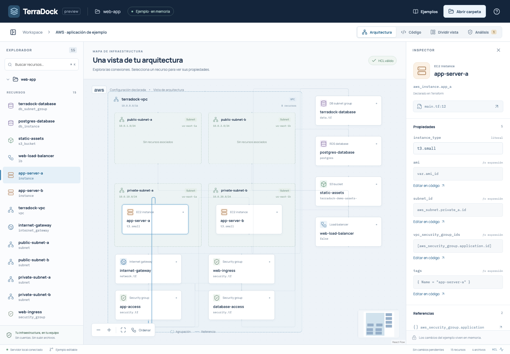

# TerraDock

**Tu infraestructura, conectada con su código.**

TerraDock es un editor visual de Terraform que corre en tu equipo. Abres una carpeta con archivos `.tf` y ves sus recursos como un diagrama. Lo que cambias en el código aparece en el diagrama al instante, y lo que cambias en el diagrama se escribe en el código.



> Proyecto en desarrollo. Revisa el [alcance y los límites](docs/limitations.md) antes de usarlo con un proyecto real.

## Empezar

### Opción 1: probarlo en el navegador

Abre la [demo interactiva](https://terradock.renzoaguilar.dev/demo/). No instalas nada ni creas una cuenta. Trae un ejemplo que puedes editar y descargar.

### Opción 2: descargarlo para usar tus archivos

TerraDock es un único archivo, sin instalador ni dependencias. Elige el de tu sistema:

| Sistema | Procesador                        | Descarga                                                                                                                      |
| ------- | --------------------------------- | ----------------------------------------------------------------------------------------------------------------------------- |
| macOS   | Apple Silicon (M1, M2, M3, M4…)   | [terradock_darwin_arm64.tar.gz](https://github.com/RenzoAL7/TerraDock/releases/latest/download/terradock_darwin_arm64.tar.gz) |
| macOS   | Intel                             | [terradock_darwin_amd64.tar.gz](https://github.com/RenzoAL7/TerraDock/releases/latest/download/terradock_darwin_amd64.tar.gz) |
| Windows | x64 (casi todos los equipos)      | [terradock_windows_amd64.zip](https://github.com/RenzoAL7/TerraDock/releases/latest/download/terradock_windows_amd64.zip)     |
| Windows | ARM (Snapdragon, Surface Pro X)   | [terradock_windows_arm64.zip](https://github.com/RenzoAL7/TerraDock/releases/latest/download/terradock_windows_arm64.zip)     |
| Linux   | x64 (`uname -m` dice `x86_64`)    | [terradock_linux_amd64.tar.gz](https://github.com/RenzoAL7/TerraDock/releases/latest/download/terradock_linux_amd64.tar.gz)   |
| Linux   | ARM64 (`uname -m` dice `aarch64`) | [terradock_linux_arm64.tar.gz](https://github.com/RenzoAL7/TerraDock/releases/latest/download/terradock_linux_arm64.tar.gz)   |

¿No sabes qué Mac tienes? Menú Apple → **Acerca de esta Mac**. Si dice «Chip Apple M…», es Apple Silicon.

Todas las versiones y sus sumas de verificación están en [Releases](https://github.com/RenzoAL7/TerraDock/releases).

**Después de descargar:**

1. **Descomprime el archivo.** Dentro está el programa `terradock` (`terradock.exe` en Windows).
2. **Ábrelo desde la carpeta de tus proyectos.** En una terminal, entra en la carpeta que contiene tus archivos `.tf` y ejecútalo. TerraDock solo puede abrir esa carpeta y lo que contiene.
3. **Usa el navegador.** Se abre solo en [http://127.0.0.1:7331](http://127.0.0.1:7331). Pulsa **Abrir carpeta**, elige un proyecto y edita en el código o en el diagrama.
4. **Para cerrarlo,** pulsa `Ctrl+C` en la terminal.

En macOS y Linux, desde la terminal:

```sh
cd ~/mis-proyectos-terraform
curl -L https://github.com/RenzoAL7/TerraDock/releases/latest/download/terradock_darwin_arm64.tar.gz | tar -xz
./terradock
```

Cambia `darwin_arm64` por el nombre de tu sistema en la tabla.

**La primera vez:**

- **macOS** puede decir que no puede verificar al desarrollador, porque el programa no está firmado. Ejecuta `xattr -d com.apple.quarantine terradock` en la carpeta donde lo descomprimiste. Si lo descargaste con `curl`, no hace falta.
- **Windows** puede mostrar SmartScreen. Pulsa **Más información** → **Ejecutar de todas formas**.

Opciones útiles:

```sh
terradock --root ~/proyectos   # Carpeta que TerraDock puede abrir (por defecto, la actual)
terradock --port 8080          # Otro puerto (por defecto, 7331)
terradock --open=false         # No abrir el navegador
terradock --version
```

## ¿Qué necesito?

| Quiero…                                 | Necesito                                                                                |
| --------------------------------------- | --------------------------------------------------------------------------------------- |
| Probarlo sin instalar nada              | Un navegador: [demo](https://terradock.renzoaguilar.dev/demo/)                          |
| Ver y editar mi Terraform               | Solo el archivo de TerraDock. No necesito Terraform, cuenta ni credenciales             |
| Desplegar en un AWS simulado (opcional) | Además: Docker, la CLI de [Floci](https://floci.io) y Terraform u OpenTofu en el `PATH` |

Tus archivos no salen de tu equipo. TerraDock escucha solo en `127.0.0.1`, así que otros equipos de tu red no pueden conectarse.

## Qué puedes hacer

- **Ver tu arquitectura.** Cada recurso declarado es un nodo, y sus referencias son las conexiones.
- **Editar en ambos sentidos, en tiempo real.**
  - Lo que escribes en el código actualiza el diagrama y el inspector en unos 60 ms.
  - Lo que cambias en el inspector se escribe en el código al momento.
  - Si editas el archivo con otro programa (VS Code, vim…), el cambio aparece al instante.
- **Navegar.** Al seleccionar un nodo se marca su bloque en el código. Al mover el cursor por el código se selecciona su nodo.
- **Guardar sin pensar.** El autoguardado escribe el archivo cuando el HCL es válido. Si otro programa cambió el archivo, se detiene y conserva tu borrador. Puedes desactivarlo y guardar con ⌘/Ctrl + S.
- **Ver errores.** Los errores de sintaxis aparecen en el editor. Mientras el HCL es inválido, el diagrama mantiene la última versión válida.

Funciona con proyectos grandes: con 300 recursos, un cambio llega al diagrama en menos de 200 ms ([mediciones](docs/performance.md)).

El diagrama muestra la **configuración declarada**. No muestra lo que existe en tu cuenta de AWS ni predice un plan. Las expresiones que necesitan a Terraform para resolverse se muestran tal cual.

## Desplegar en local con Floci (opcional)

La pestaña **Floci** ejecuta `terraform plan`, `apply` y `destroy` contra [Floci](https://floci.io), un emulador de AWS que corre en Docker en tu equipo. Sirve para probar sin tocar una cuenta real.

```sh
floci start          # o el botón «Iniciar Floci» del panel
terradock
```

- El plan marca cada nodo con su acción: `+ crear`, `~ actualizar`, `± reemplazar` o `− eliminar`. Después de aplicar, los nodos desplegados aparecen como `✓ en Floci`.
- «Aplicar» ejecuta exactamente el plan que revisaste. Si los archivos cambian, hay que generar otro plan.
- Terraform trabaja sobre una **copia privada** de tus archivos guardados. Tu carpeta no se modifica.
  - Los endpoints de Floci y las credenciales de prueba solo existen en esa copia.
  - Tus variables `AWS_*` reales se descartan.
- Las variables se leen de `terraform.tfvars` y `*.auto.tfvars`. Las que falten se escriben en el panel y solo se guardan en memoria.
- Solo se aceptan endpoints locales (`localhost`, `127.0.0.1` o `*.floci.io`). Para otro puerto: `terradock --floci-endpoint http://localhost:4566`.

## Para desarrolladores

### Compilar desde el código

Necesitas Go 1.25 o superior, Node.js 24, npm y Make.

```sh
git clone https://github.com/RenzoAL7/TerraDock.git
cd TerraDock
make install   # Dependencias Go y frontend
make build     # Frontend en web/dist y programa en bin/terradock
make run       # http://127.0.0.1:7331
```

Este `bin/terradock` lee el frontend de `web/dist`. Para crear archivos autocontenidos como los publicados:

```sh
VERSION=0.2.0 make package   # dist/terradock_<sistema>_<arquitectura>.tar.gz|zip y checksums.txt
```

### Desarrollo con recarga

En dos terminales:

```sh
make dev-api   # API Go
make dev-web   # Vite en http://127.0.0.1:5173
```

### Pruebas

```sh
make check        # Formato, análisis estático y tipos
make test         # Pruebas Go y frontend
make e2e-install  # Instala Chromium de Playwright (una vez)
make e2e          # Flujos de navegador
make public-e2e   # Portada y demo pública
```

### Publicar una versión

Las versiones se publican con una etiqueta:

```sh
git tag v0.2.0
git push origin v0.2.0
```

El workflow **Binarios** prueba el código y compila los 6 archivos. Después ejecuta el de linux/arm64 y crea el release en GitHub.

### Sitio público

La [portada](https://terradock.renzoaguilar.dev) y la demo son estáticas y se construyen con `make public-build`. Cada push a `main` que cambia la portada crea una imagen ARM64, la prueba y la promueve a K3s-Cortex. Un monitor revisa el sitio cada 3 horas. Los detalles están en [despliegue público](docs/public-deployment.md) y [demo en el navegador](docs/browser-demo.md).

### Estructura

```text
TerraDock/
├── cmd/terradock/   # Programa y opciones de arranque
├── internal/        # Parser HCL, espacio de trabajo, Floci y servidor HTTP
├── web/             # Interfaz React (src/), pruebas de navegador (tests/) y frontend embebido
├── examples/        # Proyectos Terraform de ejemplo
├── docs/            # Arquitectura, desarrollo, límites, rendimiento y roadmap
├── scripts/         # Empaquetado, promoción y comprobaciones
└── .github/         # CI, imágenes, binarios y monitor
```

Más información:

- [Arquitectura](docs/architecture.md)
- [Desarrollo y pruebas](docs/development.md)
- [Compatibilidad y límites](docs/limitations.md)
- [Rendimiento](docs/performance.md)
- [Roadmap](docs/roadmap.md)
- [Cómo contribuir](CONTRIBUTING.md)

## Licencia

[MIT](LICENSE).
