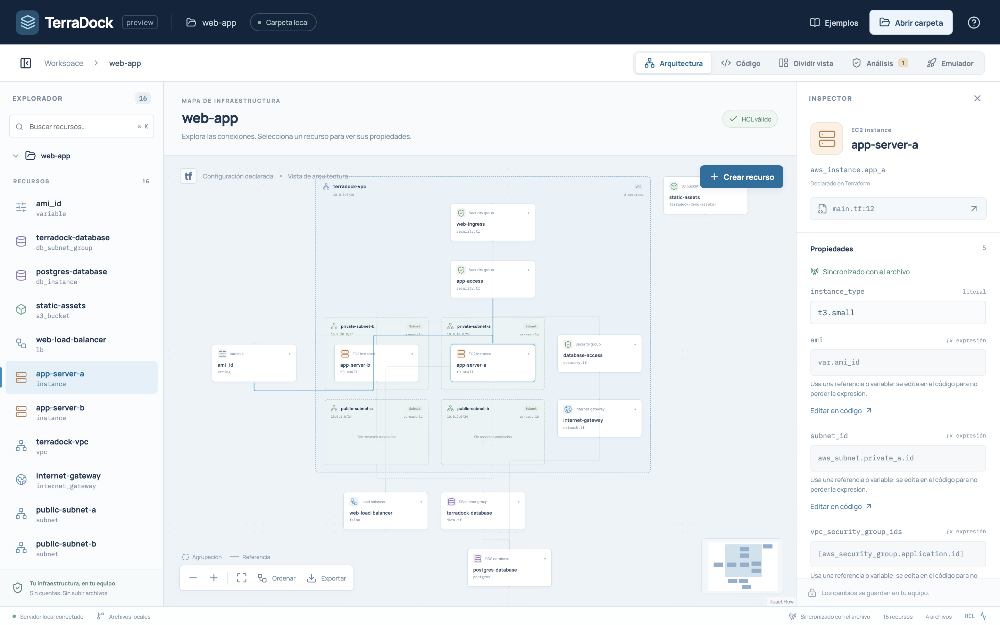

# TerraDock

**Tu infraestructura, conectada con su código.**

TerraDock es un editor visual de Terraform que corre en tu equipo. Abres una carpeta con archivos `.tf` y ves sus recursos como un diagrama. Lo que cambias en el código aparece en el diagrama al instante, y lo que cambias en el diagrama se escribe en el código.



> Proyecto en desarrollo. Revisa el [alcance y los límites](docs/limitations.md) antes de usarlo con un proyecto real.

## Empezar

### Opción 1: probarlo en el navegador

Abre la [demo interactiva](https://terradock.renzoaguilar.dev/demo/). Sin instalar nada ni crear una cuenta.

### Opción 2: descargarlo para usar tus archivos

Un único archivo, sin instalador ni dependencias:

| Sistema | Procesador                        | Descarga                                                                                                                      |
| ------- | --------------------------------- | ----------------------------------------------------------------------------------------------------------------------------- |
| macOS   | Apple Silicon (M1, M2, M3, M4…)   | [terradock_darwin_arm64.tar.gz](https://github.com/RenzoAL7/TerraDock/releases/latest/download/terradock_darwin_arm64.tar.gz) |
| macOS   | Intel                             | [terradock_darwin_amd64.tar.gz](https://github.com/RenzoAL7/TerraDock/releases/latest/download/terradock_darwin_amd64.tar.gz) |
| Windows | x64 (casi todos los equipos)      | [terradock_windows_amd64.zip](https://github.com/RenzoAL7/TerraDock/releases/latest/download/terradock_windows_amd64.zip)     |
| Windows | ARM (Snapdragon, Surface Pro X)   | [terradock_windows_arm64.zip](https://github.com/RenzoAL7/TerraDock/releases/latest/download/terradock_windows_arm64.zip)     |
| Linux   | x64 (`uname -m` dice `x86_64`)    | [terradock_linux_amd64.tar.gz](https://github.com/RenzoAL7/TerraDock/releases/latest/download/terradock_linux_amd64.tar.gz)   |
| Linux   | ARM64 (`uname -m` dice `aarch64`) | [terradock_linux_arm64.tar.gz](https://github.com/RenzoAL7/TerraDock/releases/latest/download/terradock_linux_arm64.tar.gz)   |

Versiones anteriores y sumas de verificación: [Releases](https://github.com/RenzoAL7/TerraDock/releases).

Descomprímelo y ejecútalo desde la carpeta de tus archivos `.tf`. Se abre en [http://127.0.0.1:7331](http://127.0.0.1:7331); para cerrarlo, `Ctrl+C`. En macOS o Linux:

```sh
cd ~/mis-proyectos-terraform
curl -L https://github.com/RenzoAL7/TerraDock/releases/latest/download/terradock_darwin_arm64.tar.gz | tar -xz
./terradock
```

Cambia `darwin_arm64` por tu sistema. La primera vez, macOS puede bloquearlo por no estar firmado (`xattr -d com.apple.quarantine terradock`, no hace falta si usaste `curl`), y Windows puede mostrar SmartScreen (**Más información** → **Ejecutar de todas formas**).

```sh
terradock ./infra              # Abrir ese proyecto al arrancar
terradock --root ~/proyectos   # Carpeta que TerraDock puede abrir
terradock --port 8080          # Otro puerto (por defecto, 7331)
terradock --open=false         # No abrir el navegador
```

TerraDock solo puede abrir la carpeta elegida y escucha solo en `127.0.0.1`. Tus archivos no salen de tu equipo.

## Qué puedes hacer

- **Ver tu arquitectura.** Cada recurso es un nodo dentro de su VPC o subred, y sus referencias son las conexiones. Variables, locals, outputs y proveedores también aparecen.
- **Editar en ambos sentidos, en tiempo real.** El código, el inspector y cualquier otro editor (VS Code, vim…) actualizan el diagrama al instante, también con cientos de recursos ([mediciones](docs/performance.md)).
- **Crear recursos desde el diagrama** con los tipos AWS más comunes y sus atributos obligatorios. **Deshacer** lo quita.
- **Un diagrama que no se descoloca.** Se ordena por capas al abrir; mientras editas, nada cambia de sitio. **Ordenar** lo reordena cuando quieras.
- **Exportar** el diagrama completo como SVG o PNG.
- **Guardar sin pensar.** El autoguardado solo escribe HCL válido, detecta cambios hechos por otros programas y conserva tus borradores al cerrar la pestaña.
- **Ver errores** de sintaxis en el editor, mientras el diagrama mantiene la última versión válida.

El diagrama muestra la **configuración declarada**, no lo que existe en tu cuenta de AWS ni un plan.

## Desplegar en un emulador local (opcional)

La pestaña **Emulador** ejecuta `terraform plan`, `apply` y `destroy` contra un AWS simulado en tu equipo, sin tocar una cuenta real.

| Emulador                                                           | Qué es                     | Necesitas                                      |
| ------------------------------------------------------------------ | -------------------------- | ---------------------------------------------- |
| [Floci](https://floci.io) (por defecto)                            | Emulador de código abierto | Docker, la CLI de Floci y Terraform u OpenTofu |
| [AWS Emulator](https://github.com/aws/aws-emulator) (experimental) | Emulador oficial de AWS    | Docker y Terraform u OpenTofu                  |

- El plan marca cada nodo: `+ crear`, `~ actualizar`, `± reemplazar` o `− eliminar`. «Aplicar» ejecuta exactamente el plan revisado.
- Terraform trabaja sobre una **copia privada** de tus archivos, sin tus credenciales `AWS_*` reales. Tu carpeta no se modifica.
- Editar y ver el diagrama nunca ejecutan Terraform ni contactan el emulador.

Detalles de red, variables y límites de cada emulador en [compatibilidad y límites](docs/limitations.md#emuladores-locales).

## Para desarrolladores

Necesitas Go 1.25 o superior, Node.js 24, npm y Make.

```sh
git clone https://github.com/RenzoAL7/TerraDock.git && cd TerraDock
make install   # Dependencias Go y frontend
make build     # Frontend en web/dist y programa en bin/terradock
make run       # http://127.0.0.1:7331
make dev-api   # y en otra terminal: make dev-web (recarga en caliente)
make check     # Formato, análisis estático y tipos
make test      # Pruebas Go y frontend
make e2e       # Flujos de navegador (antes, una vez: make e2e-install)
```

Para publicar una versión, crea y sube una etiqueta `vX.Y.Z`: el workflow **Binarios** compila los 6 archivos y crea el release. La [portada](https://terradock.renzoaguilar.dev) y la demo se construyen con `make public-build` y se despliegan desde `main` ([despliegue público](docs/public-deployment.md)).

Más: [arquitectura](docs/architecture.md) · [desarrollo y pruebas](docs/development.md) · [límites](docs/limitations.md) · [rendimiento](docs/performance.md) · [roadmap](docs/roadmap.md) · [cómo contribuir](CONTRIBUTING.md)

## Licencia

[MIT](LICENSE).
