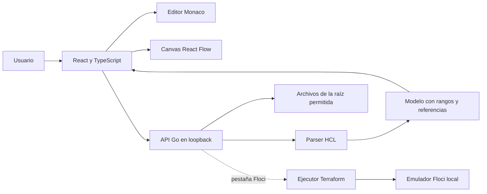

# Arquitectura de la demo

TerraDock mantiene el proyecto en el equipo del usuario. El navegador presenta el editor y el diagrama; Go controla el acceso a archivos e interpreta Terraform con las bibliotecas HCL de HashiCorp. El frontend compilado se sirve junto a la API.

## Responsabilidades

| Capa | Responsabilidad | Límite |
| --- | --- | --- |
| `cmd/terradock` | Opciones de arranque, servidor HTTP y apertura del navegador (`--open`) | No contiene lógica de interpretación |
| `internal/` | Modelo, interpretación, acceso al proyecto y API | Abrir, analizar y editar no ejecutan Terraform ni contactan AWS ni Floci |
| `internal/floci` | Estado del emulador y `terraform plan`, `apply` y `destroy` contra Floci, solo desde su pestaña | Endpoint de loopback o `*.floci.io` (debe resolver a tu equipo); copia privada; sin las variables `AWS_*` del usuario y, de las `TF_*`, solo `TF_CLI_CONFIG_FILE` y `TF_TOKEN_*`. `terraform init` descarga providers la primera vez en cada proyecto y `floci start` puede descargar su imagen Docker |
| `web/src/` | Navegación, borradores, editor, canvas e inspector | El diagrama se deriva del modelo interpretado |
| `web/embed.go` | Incrusta `web/dist` en el ejecutable con la etiqueta de build `embed` | Sin esa etiqueta (`web/noembed.go`), el frontend se lee de `--assets` |
| `examples/` | Entradas didácticas para probar el flujo | No son un despliegue verificado |
| `web/tests/` | Escenarios de usuario sobre servicios locales | No validan recursos en AWS |

## Modelo de Terraform

El análisis considera los `.tf` del directorio seleccionado como un módulo raíz. Cada recurso conserva su dirección, tipo, nombre y ubicación de origen. Las relaciones se extraen de referencias presentes en las expresiones; sus etiquetas y direcciones deben poder justificarse desde el código.

Además de los recursos, el modelo incluye fuentes de datos, módulos, variables, locals (una declaración por clave), outputs y proveedores. El campo `block` de cada declaración indica su clase, y su `id` usa la sintaxis con la que Terraform la referencia (`var.region`, `local.name`, `output.ip`, `provider.aws.west`), de modo que una referencia en el código resuelve directamente a su nodo. Cada propiedad que el inspector no edita lleva `readOnlyReason`, un motivo en español.

El parser interpreta sintaxis HCL. No sustituye el motor de evaluación de Terraform ni los esquemas de los proveedores. Los bloques con `count` o `for_each` son declaraciones; no se expanden a un número inventado de instancias. Los valores dependientes de variables, funciones o proveedores se mantienen como expresiones.

La edición desde el inspector se restringe a los literales reconocidos. Una operación debe apuntar al rango de la expresión original y verificar la revisión antes de escribir. El código no editado visualmente conserva su contenido. El [documento de limitaciones](limitations.md) delimita las garantías de esta demo y lo que falta para la edición fiable prevista en el roadmap.

## Dos contextos de trabajo

La interfaz permite explorar una demostración y abrir un proyecto local. El contexto activo debe ser visible. Las operaciones sobre un ejemplo temporal no deben hacerse pasar por una modificación de una carpeta del usuario.

En modo local, `--root` delimita el espacio accesible. Abrir una carpeta selecciona el módulo que se analizará dentro de esa raíz. No se agrega recursivamente cualquier `.tf` encontrado: cada módulo mantiene su contexto.

Al arrancar, `cmd/terradock` decide el primer proyecto: la carpeta indicada como argumento (o `--open-path`), que debe abrirse o el programa termina con un error; si no se indica, la raíz cuando contiene archivos `.tf`; y si no, el ejemplo en memoria. Sin `--root` explícito, la carpeta indicada también es la raíz permitida. Abrir un proyecto solo lee archivos; nunca ejecuta Terraform.

## Contrato de la API local

`GET /api/session` devuelve el token de sesión, `instanceId`, raíz permitida, modo y versión. Las mutaciones requieren `Content-Type: application/json` y el encabezado `X-TerraDock-Session`. El servidor comprueba el host de loopback y el origen; la excepción de desarrollo admite únicamente el origen exacto configurado y no habilita CORS.

| Petición | Datos relevantes |
| --- | --- |
| `GET /api/project` | Snapshot del proyecto activo |
| `GET /api/directories?path=...` | Directorios navegables dentro de la raíz |
| `POST /api/demo` | `template`: `basic-vpc` o `web-app`; abre una copia en memoria |
| `POST /api/open` | `path`: carpeta del módulo raíz |
| `PUT /api/files` | `projectId`, `path`, `content`, `expectedRevision` |
| `PATCH /api/properties` | `projectId`, `resourceId`, `property`, `value`, `expectedRevision` |
| `POST /api/analyze` | `projectId`, `files` (ruta → contenido del borrador); devuelve recursos, relaciones y diagnósticos sin escribir |
| `POST /api/edit-draft` | `projectId`, `path`, `content`, `resourceId`, `property`, `value`; devuelve el `content` editado sin escribir |
| `POST /api/resource-draft` | `projectId`, `path`, `content`, `expectedRevision`, `resource` (`type`, `name`, `attributes`: `{name, value}` literal o `{name, expression}`); devuelve `content` con el bloque añadido al final y su `line`, sin escribir. `409 revision_conflict` si el archivo cambió desde `expectedRevision`; `400 duplicate_resource` o `400 invalid_resource` |
| `POST /api/resource-file` | `projectId`, `path` (nombre `.tf` sin carpetas), `resource`; crea el archivo con `O_EXCL` y devuelve el snapshot. `409 file_exists` si ya existe |
| `GET /api/floci` | Estado: endpoint, si el emulador responde, Terraform detectado y su versión, trabajo actual, plan, recursos desplegados y variables |
| `POST /api/floci/run` | `action` (`start`, `plan`, `apply`, `destroy` o `refresh`), `projectId`, `variables`; responde `202` con el trabajo, `409 floci_error` si hay otro en curso y `400 floci_error` ante una acción o un proyecto no válidos |
| `POST /api/floci/cancel` | Cuerpo `{}`; cancela el trabajo en curso |
| `GET /api/events` | Stream SSE con eventos `project` y snapshots completos |

`cmd/terradock` siempre crea el ejecutor de Floci; las rutas de Floci solo responden `503 floci_unavailable` cuando el servidor se construye sin él, como en algunas pruebas. La revisión esperada corresponde al hash del archivo de origen, también para editar una propiedad. El servidor verifica `projectId` bajo el mismo bloqueo que el guardado; una operación destinada al proyecto anterior recibe `409 project_conflict`, incluso cuando los dos proyectos contienen archivos con el mismo nombre y contenido. Una revisión obsoleta recibe `409 revision_conflict`. Las respuestas de error incluyen `code` y `error`.

## Orden de actualizaciones y borradores

Cada snapshot incluye `instanceId` y `sequence`. `instanceId` es un identificador público aleatorio de la instancia del gestor, independiente del token de autenticación. `sequence` aumenta con cada actualización publicada, incluido cambiar de ejemplo o carpeta, los errores de lectura y su recuperación. Cambiar de proyecto no reinicia la secuencia; iniciar otro proceso genera una identidad nueva.

HTTP y SSE pueden llegar en un orden distinto al de las operaciones. El cliente confirma la identidad mediante `/api/session` y compara las secuencias dentro de esa instancia para evitar que una respuesta tardía sustituya una vista más reciente. La respuesta concreta de un guardado conserva la revisión que produjo esa operación; una actualización posterior de otro cliente no autoriza a rebasar automáticamente un borrador sobre ella.

El servidor comparte un proyecto activo entre sus pestañas. Los borradores pertenecen a cada pestaña y conservan el proyecto y revisión desde los que comenzaron. Si una modificación deja HCL inválido, se muestran la nueva fuente y sus diagnósticos mientras el gráfico conserva la última configuración válida del proyecto. La observación de cambios externos usa eventos nativos del sistema de archivos (fsnotify) con un margen de 25 ms y una lectura periódica de respaldo cada 2 s (300 ms si no hay eventos nativos). No supone un plazo máximo de actualización garantizado.

Los borradores se analizan sin escribir en disco: `POST /api/analyze` recibe el contenido de los archivos con cambios y devuelve recursos, relaciones y diagnósticos, y `POST /api/edit-draft` aplica un literal del inspector sobre el texto del borrador. Ambos usan el mismo parser y editor que el guardado. El autoguardado del cliente persiste el borrador con `PUT /api/files` cuando la vista previa confirma que el HCL es válido, con la misma comprobación de revisión que un guardado manual. Los guardados de una pestaña se hacen de uno en uno; uno pedido mientras otro está en curso espera su turno.

Crear un recurso desde el diagrama sigue el mismo camino que el inspector. `terraform.InsertResource` genera el bloque con `hclwrite` a partir de identificadores validados (los literales se codifican con `hclwrite`; las expresiones deben ser una única expresión HCL) y lo concatena al final del texto: el contenido previo queda como prefijo exacto, y el resultado se vuelve a analizar para comprobar que añade exactamente ese bloque. `POST /api/resource-draft` lo aplica sobre el borrador (o el texto guardado) y comprueba que su revisión base sigue siendo la del archivo; el cliente lo guarda como borrador y el autoguardado lo persiste con `PUT /api/files`. Para un archivo nuevo no hay revisión previa, así que `POST /api/resource-file` escribe directamente: abre la raíz permitida (`--root`) como `os.Root` y resuelve dentro de ella la ruta relativa del archivo (una carpeta sustituida por un enlace simbólico después de la comprobación no puede sacar la escritura de la raíz) y crea el archivo con `O_EXCL`, así que nunca reemplaza un archivo ni sigue un enlace simbólico. El archivo toma los permisos del primer `.tf` de la carpeta (o `0644`), siempre con lectura y escritura para el propietario, y se rechazan los nombres de dispositivo de Windows. En el cliente, `liveFile` vuelve a leer el archivo en cada intento de una edición del inspector o de una creación, porque un autoguardado puede terminar durante la petición y cambiar la revisión base. Las plantillas de la paleta son datos en `web/src/features/create/templates.ts`, compartidos con la demo pública, que usa la operación `create` de `internal/publicdemo`.

Cada recurso del análisis lleva `line` y `endLine`: el bloque completo o, en un local, solo su atributo. Para resaltar la declaración y elegir el nodo según el cursor, el editor mide los bloques con llaves sobre el texto actual (sigue siendo correcto con HCL inválido) y usa `endLine` solo en los locals, que comparten bloque.

Cada pestaña copia sus borradores en IndexedDB bajo una clave propia (raíz, carpeta, archivo e identificador de pestaña), así que dos pestañas abiertas no se pisan. Las pestañas se avisan con `BroadcastChannel` de qué archivos tienen borradores, usando el mismo identificador; el canal se cierra en `pagehide` y se reabre si la página vuelve de la caché de navegación. Al abrir un proyecto, la pestaña espera unos 100 ms a que respondan las demás antes de ofrecer borradores; las entradas de una pestaña que haya respondido durante la vida de la página no se ofrecen, no se borran y no caducan, y «Borrar borradores guardados» tampoco toca las de pestañas abiertas.

El paquete `internal/floci` ejecuta Terraform contra el emulador en una copia de trabajo, ubicada en la caché del usuario, que contiene los archivos guardados, los `tfvars` del proyecto y los archivos de override del provider `aws` y del backend `local`. El entorno del proceso no incluye las variables `AWS_*` del usuario ni sus `TF_*`, salvo `TF_CLI_CONFIG_FILE` y `TF_TOKEN_*` (mirrors y registros privados), y fija `CHECKPOINT_DISABLE=1`. `floci start` y `terraform version` reciben el entorno saneado sin ninguna `TF_*`. «Aplicar» solo ejecuta el archivo de plan generado para la misma huella de archivos.

El cliente solo pide `GET /api/floci` mientras la pestaña Floci está visible o hay una operación en curso, para que plan, aplicar y destruir sigan actualizando el diagrama aunque se salga de la pestaña. Ese estado comprueba si el endpoint responde y, una vez por proceso y fuera del bloqueo del ejecutor, lee `terraform version -json`; no se reintenta si falla. Como el estado no se refresca siempre, el diagrama no muestra marcas de un estado leído para otro proyecto y descarta las de un plan leído para una revisión guardada anterior.

## Colocación del diagrama

`buildGraph` (`web/src/features/architecture/graph.ts`) deriva la estructura (qué nodo va dentro de qué VPC o subred, y las referencias) y delega las posiciones en un layout de `features/architecture/layout/`:

- `layered.ts` es el único módulo que importa `@dagrejs/dagre`. Ordena por capas, de arriba abajo, de dentro afuera: primero cada subred, después cada VPC con sus subredes como un bloque y al final el nivel superior. No usa el modo compuesto de dagre. Una referencia entre contenedores distintos se eleva a los hijos del contenedor común más cercano, y la que une un nodo con su propio contenedor se omite. Las partes sin conexión se empaquetan en filas. Proveedores, variables y locals quedan en columnas a la izquierda y los outputs a la derecha, ordenados según la altura de sus vecinos. La entrada se ordena por id, así que el resultado no depende del orden de los archivos.
- `grid.ts` es la rejilla fija anterior. Hoy solo coloca los hijos de un contenedor que aparece mientras se escribe.
- `stable.ts` (`stabilize`) se ejecuta en cada actualización: al escribir, desde el inspector, cuando cambia un archivo en disco o al cambiar de vista. Conserva la posición de cada nodo existente, también si se renombra. Devuelve a su sitio un nodo que reaparece y coloca cada nodo nuevo en el primer hueco libre de su contenedor, junto a su primer vecino. Ajusta cada contenedor al marco de sus hijos y empuja solo a los hermanos que llegue a solapar. Para buscar hueco consulta una rejilla de cubos de 256 px con las cajas ya colocadas en el contenedor, no cada hermano. Cuando la estructura no cambia o aparece un recurso, tarda menos de 1 ms con 300 y con 1000 recursos; 500 recursos nuevos de nivel superior entre 1000 se colocan en unos 50 ms (Node, [rendimiento](performance.md)).

El layout por capas solo corre al abrir un proyecto (cambia `projectKey`, el `id` del proyecto), al pulsar **Ordenar** y cuando una actualización trae otro diagrama (`replacesDiagram` en `stable.ts`): los nodos realmente nuevos, que no estaban en pantalla ni entre las posiciones recordadas de nodos quitados, son al menos 10 y superan a los que siguen. Las bajas nunca reordenan, así que cortar y pegar, o deshacer un borrado grande, devuelve cada nodo a su sitio. Decide por `id`: un renombrado masivo cuenta como nodos nuevos. `placeUpdate` es el camino que sigue el lienzo en cada actualización; al reordenar vacía las posiciones recordadas, que pertenecían al orden anterior. El `id` de un proyecto local deriva de su ruta, así que volver a abrir la carpeta que se está viendo conserva las posiciones. `resetKey` (proyecto y vista) solo reencuadra la vista. Las posiciones del último proyecto se guardan en memoria mientras el lienzo está desmontado (vistas Código y Análisis), no en disco.

La exportación (`exportDiagram.ts`, `rasterize.ts`) serializa ese mismo modelo de nodos, no el DOM. Comparte con el lienzo iconos, colores y textos (`diagramIcons.ts`, `cardDetail`).

## Desarrollo y build

Durante el desarrollo, Vite sirve el frontend en `127.0.0.1:5173` y reenvía la API al proceso Go en `127.0.0.1:7331`. `make dev-api` permite el origen exacto de Vite mediante `--dev-origin`; esa excepción es opcional y no se necesita para el build. Durante la ejecución del build, Go sirve los archivos de `web/dist` y la API desde un mismo puerto. Monaco y sus workers se incluyen en la compilación del frontend.

Hay dos formas de ejecutable:

- `make build` genera `bin/terradock`, que lee el frontend de `web/dist` (o de la ruta indicada con `--assets`). Es la forma que usan el desarrollo y las pruebas de navegador.
- `make package` (`scripts/package.sh`) compila con `-tags embed` un binario autocontenido por plataforma (macOS, Linux y Windows; ARM64 y AMD64) con el frontend incrustado, y genera `checksums.txt`. Ese binario abre el navegador al arrancar (`--open`, activo por defecto cuando el frontend va incrustado). Si se pasa `--assets`, usa esa carpeta en lugar de la copia incrustada.

El workflow [Binarios](../.github/workflows/release.yml) ejecuta `make package` en un runner ARM, prueba el binario linux/arm64 y crea el release en GitHub al publicar una etiqueta `v*`. Los archivos aparecen cuando se publica un release (etiqueta `v*`); si los enlaces todavía no descargan nada, aún no hay ninguno publicado y hay que compilar desde el código. Los instaladores, la firma de código y las actualizaciones automáticas son trabajo posterior.

## Decisiones deliberadas

- La interfaz corre en el navegador para evitar un runtime de escritorio adicional.
- Go comparte la responsabilidad del servidor y el análisis HCL para mantener las operaciones de archivos fuera del navegador.
- El diseño visual y el código se sincronizan mediante un modelo común con origen verificable.
- Terraform solo se ejecuta desde la pestaña Floci: una vez para leer su versión cuando se abre la pestaña, y al pulsar plan, aplicar, destruir o «Leer estado», siempre contra el emulador local. Abrir una carpeta, analizar o editar nunca lo ejecuta.
- La importación de planes JSON arbitrarios y la ejecución contra cuentas AWS reales quedan fuera de esta entrega.
- Se publica compatibilidad parcial antes de ampliar recursos o evaluación semántica.

Referencias técnicas: [HCL](https://github.com/hashicorp/hcl), [módulos Terraform](https://developer.hashicorp.com/terraform/language/files), [Monaco Editor](https://github.com/microsoft/monaco-editor), [React Flow](https://reactflow.dev/) y [dagre](https://github.com/dagrejs/dagre).
