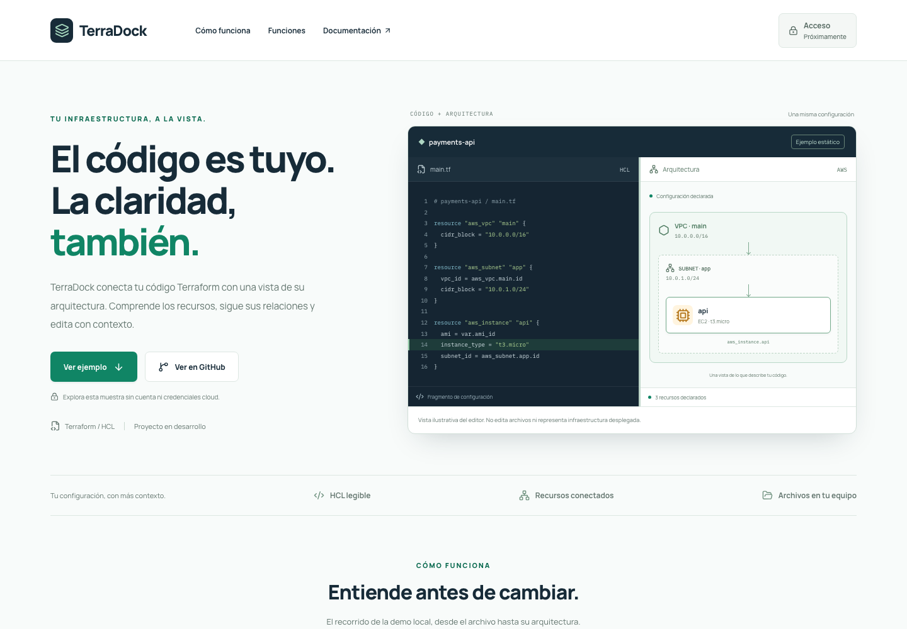

# Publicación inicial — 18 de octubre de 2026

La actualización del 19 de octubre incorpora la [demo interactiva publicada](interactive-demo.md). Este documento conserva la evidencia de la primera publicación.

**URL comprobada: http://193.122.221.201/**. La portada usa HTTP hasta configurar el dominio y TLS de TerraDock.

## Versiones

- Código de la imagen: [`32c678a3c7fc357454659ef81d675ead78886e42`](https://github.com/RenzoAL7/TerraDock/commit/32c678a3c7fc357454659ef81d675ead78886e42), rama `codex/landing-publica`.
- Manifiestos: [`fbe81631f3bdf70d6428c0c44be65f1467c59b47`](https://github.com/RenzoAL7/K3s-Cortex/commit/fbe81631f3bdf70d6428c0c44be65f1467c59b47), rama `codex/terradock-publica`.
- Imagen pública: [`ghcr.io/renzoal7/terradock-public`](https://github.com/RenzoAL7/TerraDock/pkgs/container/terradock-public).
- Digest del índice multiarch: `sha256:674c2dc01bf792ba78c8189518dfb1672b860841d7bddf99c7337ba700751816`.
- Plataformas verificadas mediante consulta anónima: AMD64 y ARM64. La VM usa ARM64.

Las ramas `main` no se modificaron. Argo CD sigue la rama de manifiestos indicada; no debe eliminarse mientras sea la fuente del despliegue.

## Validación observada

- [Publicación de imagen](https://github.com/RenzoAL7/TerraDock/actions/runs/39201360384): satisfactoria. Incluye formato, lint, diez pruebas públicas locales, build, comprobaciones HTTP del contenedor y nueve pruebas de navegador contra Nginx.
- [CI de la aplicación existente](https://github.com/RenzoAL7/TerraDock/actions/runs/39201360326): satisfactoria en calidad/tests y flujos de navegador.
- `kubectl kustomize apps/terradock/overlays/ip`: manifiestos renderizados con el digest publicado. Application validada con `--dry-run=server` antes del bootstrap.
- Argo CD `terradock-public`: **Synced / Healthy**, revisión exacta `fbe81631f3bdf70d6428c0c44be65f1467c59b47`.
- Deployment: **2/2 disponibles**, ambos pods listos, sin reinicios al verificar. Las dos réplicas están en una única VM.
- Comprobación HTTP externa: portada, tres assets iniciales, cabeceras, 404 de API/archivos privados y `release.json` correctos.
- Chromium contra la IP pública: **9 pasaron y 1 omitida**. Solo se omite la prueba de la entrada de desarrollo. Se verificaron 320, 390, 601, 768, 1024 y 1440 px, enlaces y teclado. Sin errores de consola, llamadas externas o API, cookies ni almacenamiento local.
- Capturas reales del despliegue revisadas en escritorio y móvil. También se abrió la página en el navegador del usuario.
- GPath: **Synced / Healthy**, web HTTPS 200 y `/healthz` del balanceador 200. Comparación SHA-256 de las especificaciones de sus dos Deployments, dos Services y dos Ingress: **las seis permanecieron idénticas**. No se editaron recursos OCI ni manifiestos de GPath.

Resumen estructurado: [initial-release.json](initial-release.json). Guía de actualización y reversión: [public-deployment.md](../public-deployment.md).

## Capturas del sitio desplegado

[Vista móvil completa](public-ip-mobile.png) · [Arquitectura del ejemplo en móvil](public-ip-mobile-architecture.png)
