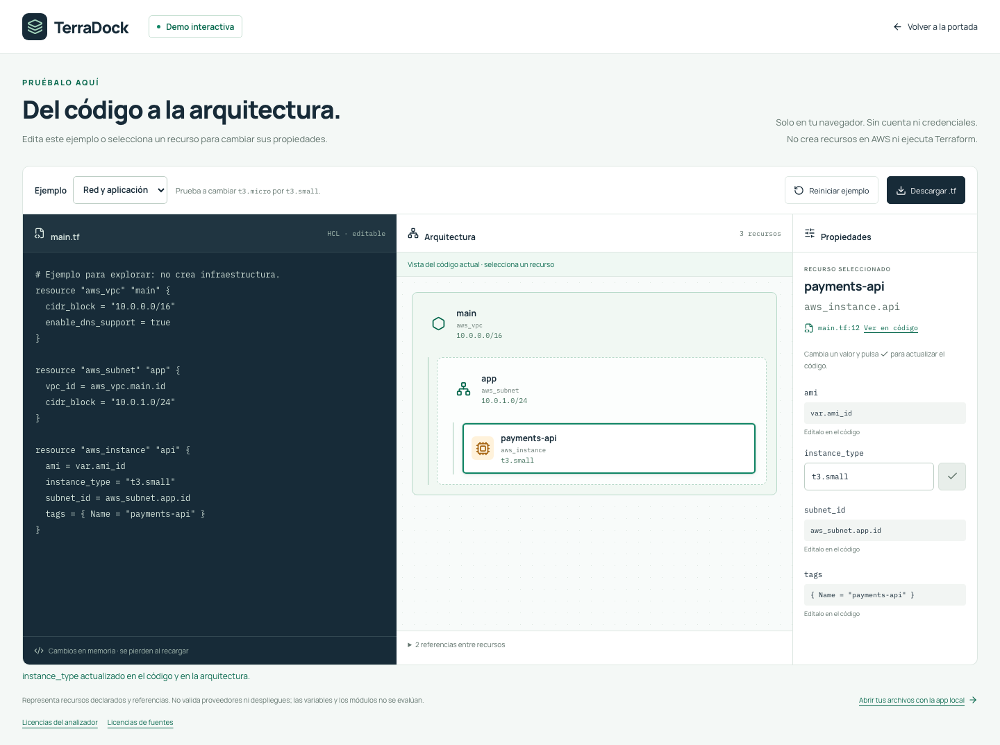

# Demo interactiva publicada — 19 de octubre de 2026

**URL verificada: http://193.122.221.201/demo/**. La portada enlaza la demo mediante **Probar demo**. El acceso por IP sigue usando HTTP; dominio y TLS están pendientes.

La demo permite editar el HCL y sus propiedades literales, seleccionar recursos, navegar a su declaración, cambiar entre dos ejemplos y descargar el archivo resultante. El análisis ocurre en el navegador con el parser real de TerraDock. No ejecuta Terraform ni crea infraestructura; los cambios viven en memoria y se descartan al recargar. Consulta el [recorrido de prueba](../browser-demo.md).

## Versiones desplegadas

- Código de la imagen: [`48e41be8efc43f74964fc0dea054a26cdc7c9dfe`](https://github.com/RenzoAL7/TerraDock/commit/48e41be8efc43f74964fc0dea054a26cdc7c9dfe), rama `codex/landing-publica`.
- Manifiestos: [`59031823ff6df69f13864b1d12d24ff0fd7354e1`](https://github.com/RenzoAL7/K3s-Cortex/commit/59031823ff6df69f13864b1d12d24ff0fd7354e1), rama `codex/terradock-publica`.
- Imagen: `ghcr.io/renzoal7/terradock-public@sha256:060f925ed2a5a32161f14deb0ade09ba8c76f21a0117321b00b515fd8610b1a4`.
- Plataformas AMD64 y ARM64 comprobadas mediante consulta anónima al registro. La VM usa ARM64.
- El cambio de manifiestos modifica únicamente el digest de TerraDock. Las ramas `main` permanecen sin modificar.

## Validación observada

- `make check`, `make test`, `make build`: satisfactorios. Incluyen formato, lint, tipos, Go vet, pruebas Go con detección de carreras y 22 pruebas del frontend. El build local conserva el aviso existente de tamaño del bundle de Monaco.
- `make e2e`: **9 pruebas** de la aplicación local satisfactorias.
- `make public-e2e`: **19 pruebas** satisfactorias, con portada y demo independientes del servidor Go.
- Contenedor Nginx local: comprobación HTTP y **18 pruebas** satisfactorias; se omite únicamente la entrada de desarrollo.
- [CI en GitHub](https://github.com/RenzoAL7/TerraDock/actions/runs/39310957276): calidad, pruebas, build local y flujos de navegador satisfactorios.
- [Construcción y publicación de imagen](https://github.com/RenzoAL7/TerraDock/actions/runs/39310957460): satisfactoria, tras comprobar frontend, parser y contenedor antes de subir ambas plataformas a GHCR.
- Argo CD `terradock-public`: **Synced / Healthy**, revisión exacta de manifiestos indicada arriba. Deployment **2/2 disponibles y actualizadas**, ambos pods listos y sin reinicios al comprobar.
- HTTP externo: ambas páginas, seis assets iniciales, cabeceras, rutas privadas 404 y `release.json` correctos para la revisión de código publicada.
- Chromium contra la IP pública: **18 pruebas satisfactorias y 1 omitida** (solo desarrollo). Se verifican edición de código y propiedades, relaciones, diagnósticos HCL, descarga con el contenido real, reinicio, recuperación tras un fallo de carga, teclado y móvil. La demo se comprueba en 320, 390, 768 y 1440 px; la portada también en 601 y 1024 px.
- Se verificó además en el navegador de la aplicación: cambiar `instance_type` a `t3.small` actualiza el código, el diagrama y el inspector. Capturas reales de escritorio y móvil inspeccionadas.
- GPath: **Synced / Healthy**, HTTPS 200 y `/healthz` del balanceador 200. Las huellas de las especificaciones de sus dos Deployments, dos Services y dos Ingress coinciden antes y después de esta actualización.

Estado estructurado y momento de comprobación: [demo-release.json](demo-release.json). Actualización y reversión: [public-deployment.md](../public-deployment.md).

## Capturas de la IP pública

[Vista móvil completa](demo-ip-mobile.png) · [Comprobación adicional en el navegador](demo-ip-browser.png)
